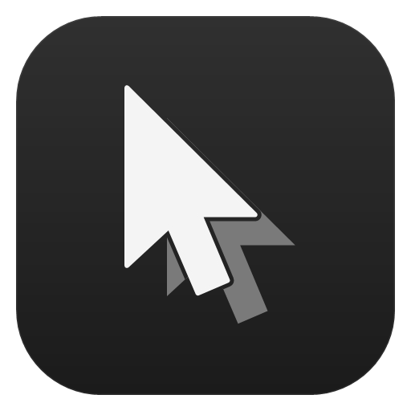
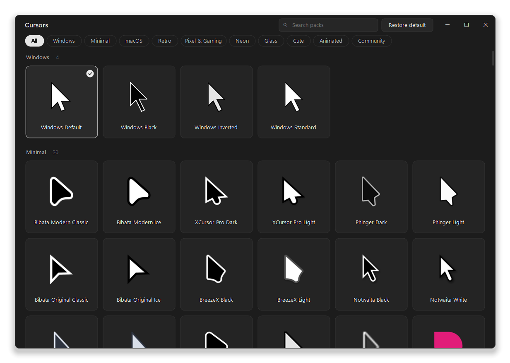
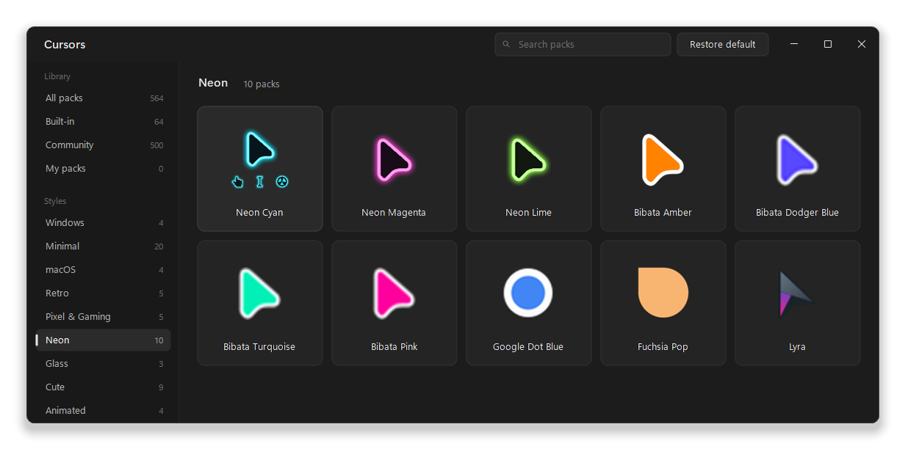
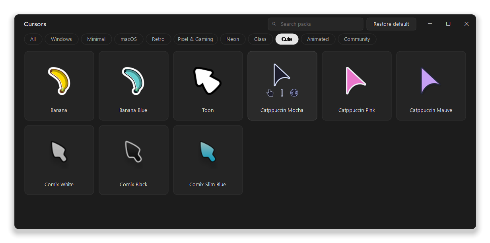
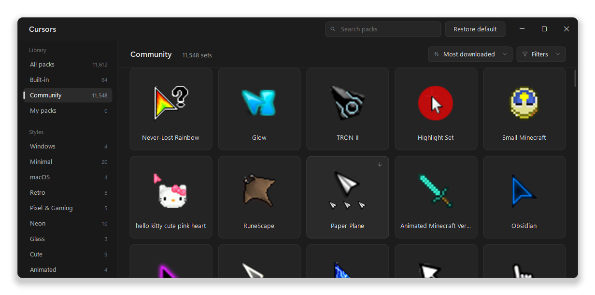

<div align="center">



# Cursors

**一键切换 Windows 鼠标指针**

一个体积小巧的原生应用，内置 60 套光标样式，另有 11,548 套社区光标套装可在线浏览。点击卡片，整套指针方案立刻生效。

[](https://github.com/rohzzn/cursors/releases/latest)


[](LICENSE)

<br>



</div>

<p align="center"><a href="README.md">English</a> · <a href="README.zh-CN.md">简体中文</a></p>

## 功能亮点

- **一次点击，整套生效。** 每张卡片都会设置 Windows 定义的全部 17 种光标：正常选择、链接选择、文本选择、忙、后台运行、四种调整大小、移动、不可用、精确定位、帮助、手写、候选、位置、人员。
- **开箱即用的 60 套光标包。** 简约、macOS 风、复古、像素与游戏、霓虹、玻璃、可爱和动态等风格，每套都标注了作者与许可。
- **11,548 套社区光标。** [rw-designer.com](https://www.rw-designer.com/cursor-library) 上所有能作为单个文件下载的光标套装，都收录在「社区」板块：142 套 Minecraft、106 套 Mario、71 套 RuneScape、70 套 Pokémon、57 套 Sonic，以及数千套其他主题。预览图随滚动加载，点一下即可下载并应用。
- **预览。** 每套都有大图预览，动态光标会播放动画；鼠标悬停时，该套的链接、文本和忙碌光标会淡入显示。
- **搜索。** 直接开始输入，即可按名称、风格或作者查找光标包。
- **浏览、排序与筛选。** 侧栏可进入「全部光标包」「内置」「社区」「我的光标包」，或直接跳到某个内置风格。社区套装可按下载量、评分或名称排序，也能筛选出完整套装、动态套装、高评分套装或开放许可套装。
- **导入自己的光标包。** 把 `.zip`、`install.inf` 或散装的 `.cur` / `.ani` 文件拖进窗口即可，角色会自动识别，`install.inf` 里顺序被打乱的条目也能正确处理。
- **从链接导入。** 粘贴或拖入光标套装页面链接（例如 [rw-designer.com](https://www.rw-designer.com/cursor-library) 上的页面），Cursors 会连同名称、许可和来源一起下载到你的光标库。
- **持久生效。** 通过与「鼠标属性」相同的设置保存选择，重启后依然有效。没有开机启动项，也没有后台进程。
- **轻量、原生。** 单个 200 KB 的 exe，启动不到一秒，空闲时不占用 CPU。支持跟随 Windows 明暗设置（也可手动指定），并兼容 Windows 11 的贴靠布局与分屏 DPI。
- **中文界面与明暗皮肤。** 界面内置简体中文和英文，可跟随系统语言；另有完整的浅色 / 深色配色，可跟随 Windows 主题实时切换。详见[界面语言与明暗主题](#界面语言与明暗主题)。
- **保护隐私。** 无需账号，没有遥测。只有在显示社区预览图、或下载你选中的套装与链接时才会联网。

## 下载

1. 从 [最新发布版](https://github.com/rohzzn/cursors/releases/latest) 下载 **`Cursors-<版本>-windows.zip`**。
2. 解压到任意位置，保持 `Cursors.exe` 与 `Packs` 文件夹在同一目录。
3. 运行 **`Cursors.exe`**。无需安装，也不需要管理员权限。首次启动会把 Cursors 添加到开始菜单和桌面，方便从 Windows 搜索中打开。

**如果出现「Windows 已保护你的电脑」：** 程序目前尚未做代码签名，SmartScreen 首次运行时可能提示。选择 **更多信息 → 仍要运行** 即可。每个发布版都附带 zip 的 SHA-256，可用于校验下载文件。

**运行要求：** Windows 10 或 11，且装有 .NET Framework 4.8（Windows 10 1903 及以上版本、Windows 11 均已内置）。Cursors 在 Windows 11 上开发与测试。

## 截图

<table>
  <tr>
    <td></td>
    <td></td>
  </tr>
  <tr>
    <td align="center"><sub>悬停卡片可查看该套光标的更多角色</sub></td>
    <td align="center"><sub>通过侧栏浏览内置风格</sub></td>
  </tr>
</table>

<p align="center"><br><sub>11,548 套社区光标，支持排序、筛选和随滚动加载的预览图</sub></p>

## 内置光标库

| 分类 | 光标包 |
| --- | --- |
| **Windows** | Windows 自带样式：Default、Black、Inverted、Standard |
| **简约 Minimal**（20） | Bibata Modern 与 Original（Classic、Ice）、XCursor Pro Dark 与 Light、Phinger Dark 与 Light、BreezeX Black 与 Light、Notwaita Black 与 White、Nordzy、Nordzy White、Android、Modern Inverted、Vimix、Fuchsia、Google Dot Black 与 White |
| **macOS**（4） | macOS、macOS White、WhiteSur、Capitaine |
| **复古 Retro**（5） | Hackneyed、Hackneyed Dark、Retrosmart Win、Retrosmart Mac、Retrosmart Terminal |
| **像素与游戏 Pixel & Gaming**（5） | Pixel、Adventure、Sci-Fi、Future、XCursor Pro Red |
| **霓虹 Neon**（10） | Neon Cyan、Neon Magenta、Neon Lime、Bibata Amber、Bibata Dodger Blue、Bibata Turquoise、Bibata Pink、Google Dot Blue、Fuchsia Pop、Lyra |
| **玻璃 Glass**（3） | Ghost、Spirit、Tinted Glass |
| **可爱 Cute**（9） | Banana、Banana Blue、Toon、Catppuccin Mocha、Pink 与 Mauve、Comix White、Black 与 Slim Blue |
| **动态 Animated**（4） | Rainbow Modern、Rainbow Original、Bee、Zebra |

> 中文界面里这些分类分别显示为：Windows、简约、macOS、复古、像素与游戏、霓虹、玻璃、可爱、动态。`pack.ini` 中仍使用英文分类 ID，因此切换语言不会打乱分组。

每一套在收录前都经过检查：

- **解析：** 逐个文件解析并解码。
- **加载：** 用 Windows 自己的 `LoadCursorFromFile` 载入每个文件。
- **热点：** 每个热点都落在其图像范围内。
- **空白图像：** 排除没有任何内容的图像。
- **总览图：** 人工查看过每张包含全部角色的总览图。
- **真实应用：** 逐套实际应用，确认 Windows 载入了全部 17 个光标。

许可不明确的作品（例如 Figma、Minecraft 以及其他游戏或品牌光标）有意不收入内置库。热门的玩家自制游戏套装放在[社区套装](#社区套装)板块，选中时才从 rw-designer.com 下载。

## 使用方法

| 想要… | 这样做 |
| --- | --- |
| 应用某套光标 | 点击它的卡片，或用方向键加 <kbd>Enter</kbd> |
| 查看某套光标的更多角色 | 鼠标悬停在卡片上 |
| 查找光标包 | 直接开始输入，或按 <kbd>Ctrl</kbd>+<kbd>F</kbd>。<kbd>Esc</kbd> 清空搜索，<kbd>Enter</kbd> 或 <kbd>↓</kbd> 跳到结果 |
| 切换视图或风格 | 在侧栏选择，或按 <kbd>Ctrl</kbd>+<kbd>Tab</kbd> 依次切换 |
| 排序或筛选社区套装 | 使用「全部光标包」或「社区」顶部的排序与**筛选**菜单 |
| 获取社区套装 | 打开「社区」并点击卡片，套装会下载、应用并保留在你的光标库中 |
| 恢复 Windows 默认光标 | 点击标题栏的**恢复默认** |
| 切换界面语言 | 点击标题栏的地球按钮（中文 / EN / 自动） |
| 切换明暗皮肤 | 点击标题栏的太阳／月亮按钮，或按 <kbd>Ctrl</kbd>+<kbd>Shift</kbd>+<kbd>T</kbd> |
| 添加自己的光标包 | 使用**添加光标包 → 从文件添加…** 或 <kbd>Ctrl</kbd>+<kbd>O</kbd>，也可以把文件夹和 zip 拖进窗口 |
| 从链接添加光标包 | 使用**添加光标包 → 从链接添加…** 或 <kbd>Ctrl</kbd>+<kbd>L</kbd>；复制链接后按 <kbd>Ctrl</kbd>+<kbd>V</kbd>，或从浏览器把链接拖进窗口 |
| 查看作者信息、项目页面或文件 | 右键点击卡片 |
| 移除自己添加的光标包 | 右键点击，选择**从光标库中移除** |
| 重新扫描光标库 | <kbd>F5</kbd> |
| 不打开窗口就恢复默认 | 运行 `Cursors.exe --restore` |

## 社区套装

「社区」板块按下载量从高到低列出 [rw-designer.com](https://www.rw-designer.com/cursor-library) 上 11,548 套可单文件下载的光标套装。网站标记为成人内容的套装，以及名称中含有露骨或仇恨用语的套装已被排除。用**筛选 → 完整套装**可以只显示覆盖全部 15 个光标的套装。

- **不随程序分发。** 应用只附带一份清单 [`packs/catalog.tsv`](packs/catalog.tsv)：名称、作者、下载量、许可和链接。
- **预览随滚动加载。** 卡片滚入视野时，才从 rw-designer.com 取对应预览图，一次只加载几张，并缓存在 `%LOCALAPPDATA%\Cursors\Catalog`。
- **排序与筛选。** 按**下载最多**、**评分最高**或**名称**排序；**筛选**可限定为完整套装（全部 15 个光标）、动态光标、网站高评分套装，或公有领域与 CC BY 许可。标题栏会显示匹配数量。
- **一键应用。** 点击卡片即下载该套装，按网站标注的角色映射每个文件，加入光标库并应用。之后这张卡片和其他光标包一样可以离线使用。
- **许可来自作者。** 右键点击卡片可查看作者、许可和下载量，或打开它的页面。

清单由 `tools\update-catalog.ps1` 刷新，参见[从源码构建](#从源码构建)。

## 从链接导入

在光标网站上看到喜欢的套装？复制它的页面链接，在 Cursors 里按 <kbd>Ctrl</kbd>+<kbd>L</kbd>，或者直接从浏览器把链接拖进窗口。

| 链接 | Cursors 的处理方式 |
| --- | --- |
| rw-designer.com 的套装页面，如 `https://www.rw-designer.com/cursor-set/…` | 读取一次页面取得名称、许可和下载量，然后下载该套装 |
| rw-designer.com 的单个光标页面 | 下载这一个光标 |
| 指向 `.zip`、`.cur` 或 `.ani` 文件的直链 | 下载该文件 |

只会下载你给出的链接，不会上传任何内容。单个下载上限为 50 MB。套装会复制到「已添加」分类下，并根据 `Diamond Sword - Normal Select.cur` 这类文件名推断角色。右键可查看作者、许可和来源页面。

导入的套装只保存在你的电脑上，绝不会被加入本项目。每套的许可由上传者选定，分享或再次使用前请先确认。

## 工作原理

- **应用。** Cursors 把方案写入 `HKCU\Control Panel\Cursors`，再用 `SystemParametersInfo(SPI_SETCURSORS)` 通知 Windows 重新加载，机制与「鼠标属性」完全相同。Windows 登录时会重新读取这些值，因此无需任何常驻进程。
- **安装。** 首次应用某套光标时，其文件会复制到 `%LOCALAPPDATA%\Cursors`，所以即使移动或删除应用，光标依然可用。
- **撤销。** 首次启动时，Cursors 会保存你当前的光标配置。如果这套配置不属于任何内置光标包，它会出现在「已添加」中，方便随时恢复。

**写入位置：** `HKCU\Control Panel\Cursors`、`%LOCALAPPDATA%\Cursors`（设置、已安装的光标包、你添加的光标包与社区预览缓存），以及开始菜单和桌面上的 Cursors 快捷方式。

## 卸载

1. 运行 `Cursors.exe --uninstall`，它会恢复 Windows 默认光标并移除开始菜单与桌面快捷方式。
2. 删除解压出来的文件夹。
3. 如需彻底清理，再删除 `%LOCALAPPDATA%\Cursors`。

## 常见问题

<details>
<summary><b>Cursors 会在后台运行吗？</b></summary>

不会。只有窗口打开时它才运行。关闭窗口后，你选中的光标依然生效。
</details>

<details>
<summary><b>能不能用别处下载的光标包？</b></summary>

可以。把 `.zip`、`install.inf` 或散装的 `.cur` / `.ani` 文件拖进窗口，Cursors 会把它们复制进光标库并自动判断每个光标的角色。也可以跳过下载，直接[从链接导入](#从链接导入)。
</details>

<details>
<summary><b>有 Minecraft 光标吗？</b></summary>

有。「社区」里有 142 套 Minecraft 光标，从 Minecraft - Diamond Edition 起，此外还有 RuneScape、Mario、Zelda、Sonic 和 Undertale 主题。它们不随程序分发，因为游戏光标的许可通常不允许再分发，所以都是点击时才从 rw-designer.com 下载。想要其他网站的套装，可以[从链接导入](#从链接导入)。
</details>

<details>
<summary><b>霓虹分类的光标是从哪来的？</b></summary>

目前没有采用开放许可的现成霓虹套装，因此其中三套是以 Bibata Modern Classic（GPL-3.0）为基础，重新着色轮廓并加上发光效果制作而成。转换过程已包含在本仓库的光标包工具链中。
</details>

## 界面语言与明暗主题

### 界面语言

界面内置简体中文和英文。点击标题栏右侧的地球按钮（显示「中文」/「EN」/「自动」）即可随时切换，无需重启：

- **跟随系统语言**：默认选项，Windows 显示语言为中文时自动显示中文界面。
- **简体中文** / **English**：强制使用指定语言。

选择保存在 `%LOCALAPPDATA%\Cursors\settings.ini` 的 `language` 键（`auto` / `zh-CN` / `en`）。标题栏、侧栏、菜单、筛选与排序、提示消息、空状态、对话框、文件选择器和错误提示都会随语言切换；分类名在 `pack.ini` 中仍使用英文 ID，只翻译显示名称，同时为中英文名称都建立搜索索引。社区套装的名称、作者和许可信息保持原文。

要新增语言，在 `src/Localization.cs` 中复制一份 `Strings` 实例并覆盖文案，再在 `AppLanguage`、`L.Load` 和 `L.Refresh` 中注册即可。

### 明暗主题

点击标题栏上的太阳／月亮按钮（或按 <kbd>Ctrl</kbd>+<kbd>Shift</kbd>+<kbd>T</kbd>）打开主题菜单：

- **跟随系统主题**（默认）：读取 `HKCU\...\Themes\Personalize\AppsUseLightTheme`，并监听 `WM_SETTINGCHANGE` / `WM_THEMECHANGED`。在 Windows 设置里切换应用明暗模式时，已打开的窗口会**立即**跟着变，无需重启。
- **浅色** / **深色**：强制使用指定配色。

选择保存在 `settings.ini` 的 `theme` 键（`auto` / `light` / `dark`）。切换时同步更新手绘界面、搜索框、原生右键菜单、链接导入对话框，以及 DWM 的沉浸式标题栏和窗口边框色。浅色是一套独立设计的完整调色板（白卡片、深文字、反相的选中态），不是简单地把深色反色。

> 源码含 UTF-8 中文：`Localization.cs` 带 UTF-8 BOM，`build.ps1` 使用 `/codepage:65001`，确保任何系统代码页下都能正确编译。

## 从源码构建

需要 Roslyn C# 编译器，它随 Visual Studio 或免费的 *Visual Studio 生成工具* 一起提供。

```bash
powershell -ExecutionPolicy Bypass -File build.ps1
```

这会生成 `bin\Cursors.exe`，其中 `bin\Packs` 是指向 `packs\` 的目录联接。加上 `-Package` 还会生成 `dist\Cursors-<版本>-windows.zip` 及其 SHA-256 校验文件。仓库也提供了 `Cursors.csproj`，可用于 Visual Studio、Rider 或 `dotnet build`，但尚未验证；`build.ps1` 才是经过验证的构建方式。

在没有 Visual Studio 或 .NET SDK 的机器上，可以用 `CURSORS_CSC` 环境变量指定 Roslyn 的 `csc.exe`：

```powershell
$env:CURSORS_CSC = "<Roslyn 目录>\csc.exe"
powershell -NoProfile -ExecutionPolicy Bypass -File build.ps1 -Package
```

<details>
<summary><b>从上游重建内置光标库</b></summary>

把所有上游源文件下载到一个文件夹，每个下载都会按固定的哈希或提交校验：

```bash
powershell -ExecutionPolicy Bypass -File tools\fetch-pack-sources.ps1 -Destination D:\cursor-sources
```

转换、校验并发布到 `packs\`：

```bash
powershell -ExecutionPolicy Bypass -File tools\build-packs.ps1 -Sources D:\cursor-sources -ApplyTest
```

`-ApplyTest` 会逐套真实应用光标，结束后恢复你原来的设置。完整重建能逐字节复现已发布的光标库。上游来源列在 [`tools/SOURCES.md`](tools/SOURCES.md)，每一套的描述见 [`tools/packs.recipe`](tools/packs.recipe)。
</details>

<details>
<summary><b>刷新社区清单</b></summary>

```bash
powershell -ExecutionPolicy Bypass -File tools\update-catalog.ps1
```

这会重写 `packs\catalog.tsv`。脚本只读取 rw-designer 的公开列表页和套装页面（`robots.txt` 允许），每秒一次请求，不下载任何光标文件。页面缓存三天，中断后可从断点继续。完整刷新约需读取 11,900 个页面、三个多小时。`-Count` 可只保留下载量最高的一部分，`-MinRoles` 可限定套装覆盖的最少光标角色数。
</details>

<details>
<summary><b>项目结构</b></summary>

```
src/                    应用源码（C#、WinForms、全手绘界面）
  Program.cs            入口、单实例、--restore
  MainWindow*.cs        状态、绘制、输入、自绘标题栏
  Localization.cs       全部界面文案、中英文文本、语言状态
  MainWindow.Language.cs  标题栏语言按钮与即时切换
  Theme.cs              浅色/深色配色、系统主题检测、DPI 字体
  MainWindow.Theme.cs   标题栏主题按钮与跟随 Windows 主题
  CursorScheme.cs       应用光标方案、检测当前方案
  PackLibrary.cs        Windows、内置与已添加的光标包；导入与安装
  PackDetection.cs      install.inf 解析与文件名角色推断
  LinkImport.cs         从套装页面或文件链接导入光标包
  Catalog.cs            社区清单与预览图缓存
  Shortcuts.cs          开始菜单与桌面快捷方式
  CursorImage.cs        用于预览的 .cur/.ani 解码器
packs/                  内置光标库、NOTICE.md 与 LICENSES/
tools/                  光标包配方、源文件抓取、库构建、PackTool、logo 生成
docs/                   logo 与截图
build.ps1               构建与打包
```
</details>

## 参与贡献

欢迎提交 Issue 和 Pull Request。想推荐新的光标包，请附上来源链接，并确认其许可允许再分发。想自己添加，可在 `tools/packs.recipe` 中描述，然后带 `-ApplyTest` 运行 `tools\build-packs.ps1`。中文文档如有翻译或表述问题，同样欢迎直接提 PR。

## 致谢

内置光标都是各自作者的作品：

- **个人设计者：** Kaiz Khatri（Bibata、macOS、XCursor Pro、BreezeX、Banana、Fuchsia、Google Dot 等）、Philipp Schaffrath（Phinger）、Guillaume Boehm（Nordzy）、Vince Liuice（Vimix、WhiteSur）、Keefer Rourke（Capitaine）、yeyushengfan258（Future、Lyra）、Richard Ferreira（Hackneyed）、Manuel Domínguez López（Retrosmart）、silica-dev（半透明 Bibata）、emvaized（Modern Inverted）、donut2（Notwaita）、Jens Luetkens 与 Ben Finney（ComixCursors）
- **项目：** Catppuccin、Android Open Source Project、[Kenney](https://kenney.nl)

每套光标的完整署名见 [`packs/NOTICE.md`](packs/NOTICE.md)。

## 许可

Cursors 的源码与文档采用 [MIT 许可](LICENSE)，© 2026 Rohan。

`packs/` 中的光标包是各自独立的作品，按各自的许可分发：GPL-3.0、GPL-2.0、LGPL-3.0、CC BY-SA、Apache-2.0、MIT、X11 与 CC0。详见 [`packs/NOTICE.md`](packs/NOTICE.md) 和 [`packs/LICENSES/`](packs/LICENSES)。

社区套装不属于本仓库。`packs/catalog.tsv` 只列出名称与链接，每套均由 rw-designer.com 托管，许可以该套装页面标注的作者许可为准。

---

完整版本记录见 [CHANGELOG.zh-CN.md](CHANGELOG.zh-CN.md)（英文版：[CHANGELOG.md](CHANGELOG.md)）。
